<p align="center">
  
</p>

<h1 align="center">Haki</h1>

<p align="center">
  <strong>Open-source, self-hostable, end-to-end encrypted chat.</strong><br>
  One Flutter app for iOS, Android, macOS, Windows and the web. Your server, your keys.
</p>

<p align="center">
  <a href="LICENSE"></a>
  
  
  
  
</p>

<p align="center">
  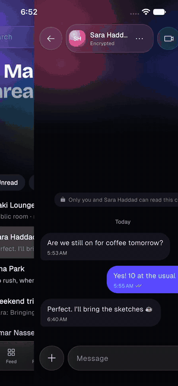
</p>

<p align="center">
  <a href="#run-it-locally">Run it in 5 minutes</a> ·
  <a href="SECURITY.md">How the encryption works</a> ·
  <a href="CONTRIBUTING.md">Contribute</a>
</p>

**What's inside:** 1:1 and group chats, voice and video calls, stories, a friends feed with photos and videos, disappearing and view-once messages, linked devices (scan a code to add your Mac or browser), and an admin console that only ever sees counts.

- **No phone number.** Your account is 12 recovery words on your device.
- **Encrypted on the device.** The server stores ciphertext for messages, media, stories and feed posts.
- **Self-host in one command.** `docker compose up` runs the API, database, dashboard and TURN server.

| Folder | What it is | Stack |
| --- | --- | --- |
| `haki-backend/` | API, WebSocket server, database | NestJS 11, TypeORM, PostgreSQL, Socket.IO |
| `haki-dashboard/` | Admin console (counts only, never content) | Next.js, Tailwind, Recharts |
| `haki_mobile/` | The app for iOS, Android, macOS, Windows and web | Flutter, BLoC + freezed |

Messages, media, stories and feed posts are encrypted on the device (AES-256-GCM, with the key wrapped per reader using RSA-OAEP). The server only stores ciphertext. The public Lounge room, profile info and metadata (who is friends with whom, timestamps, counts) are not encrypted.

## Screenshots

<p align="center">
  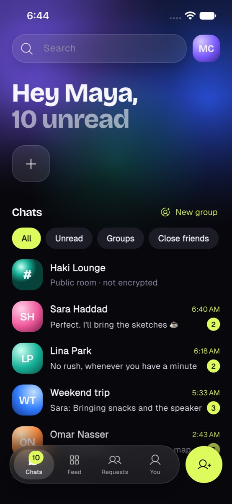
  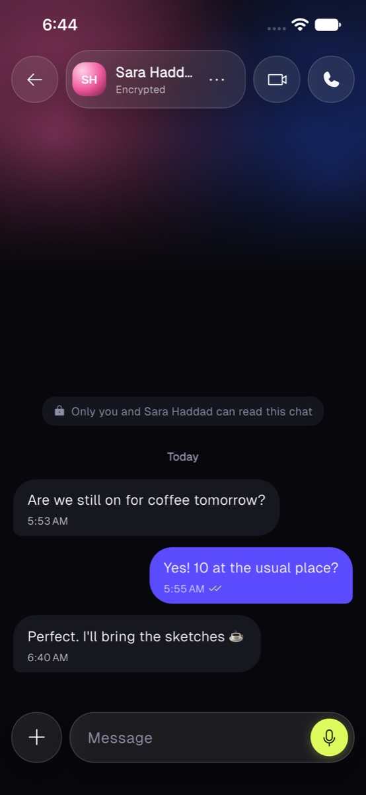
  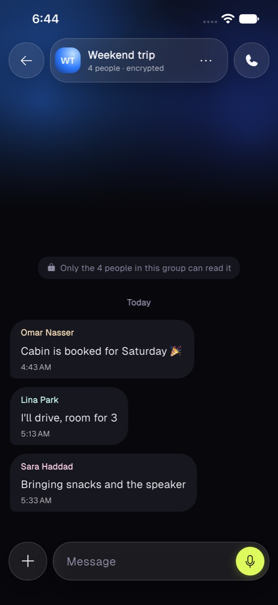
  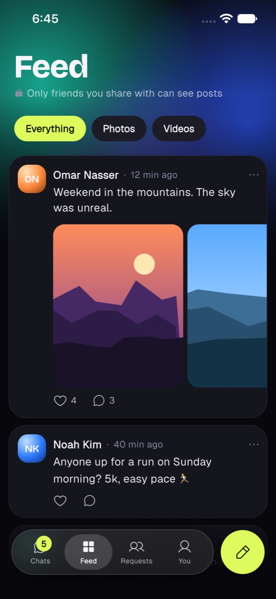
</p>

<p align="center">
  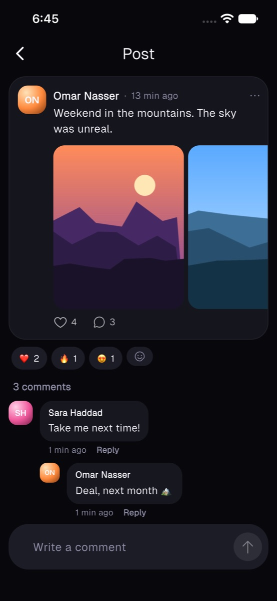
  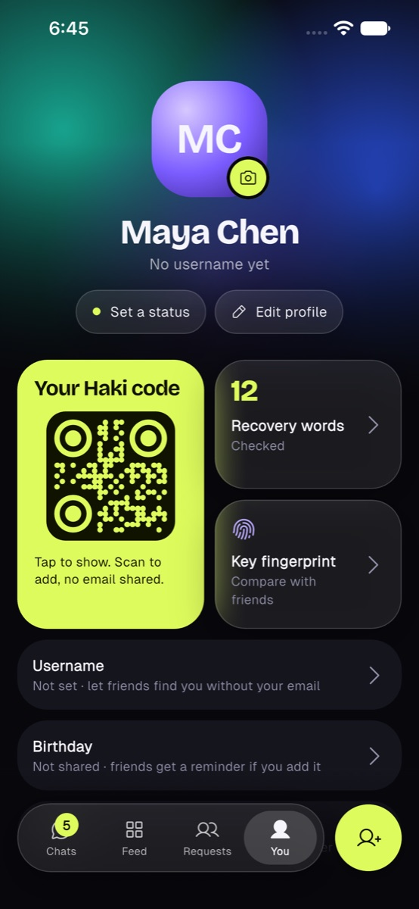
  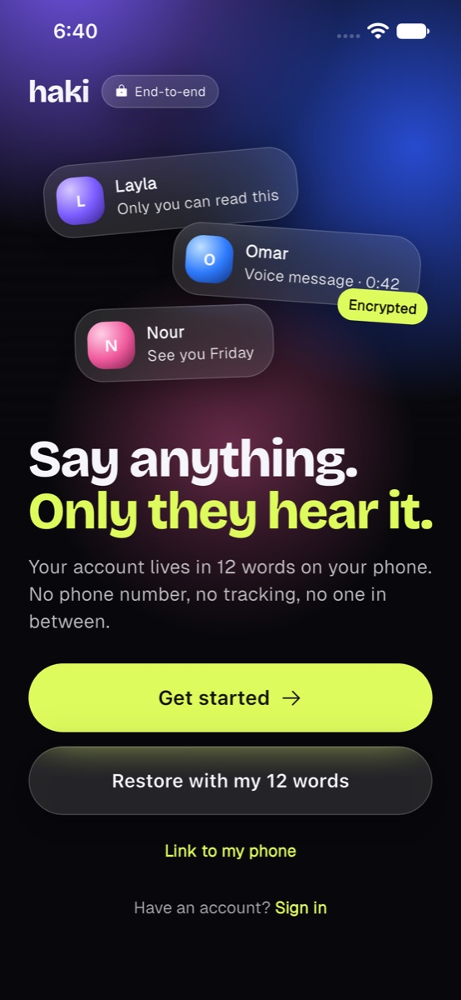
  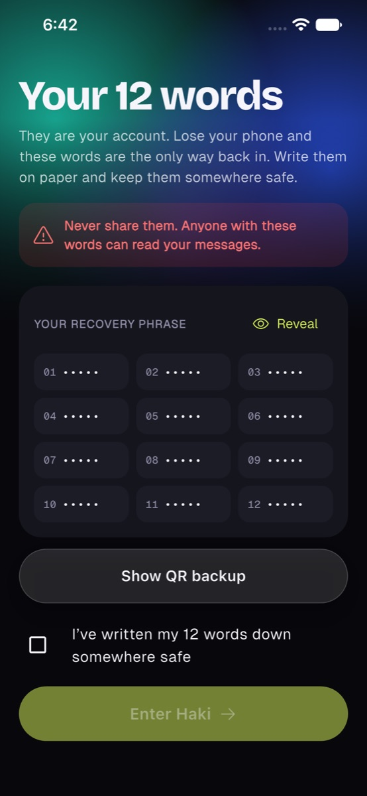
</p>

**Admin dashboard** (counts and timestamps only, never message content):

<p align="center">
  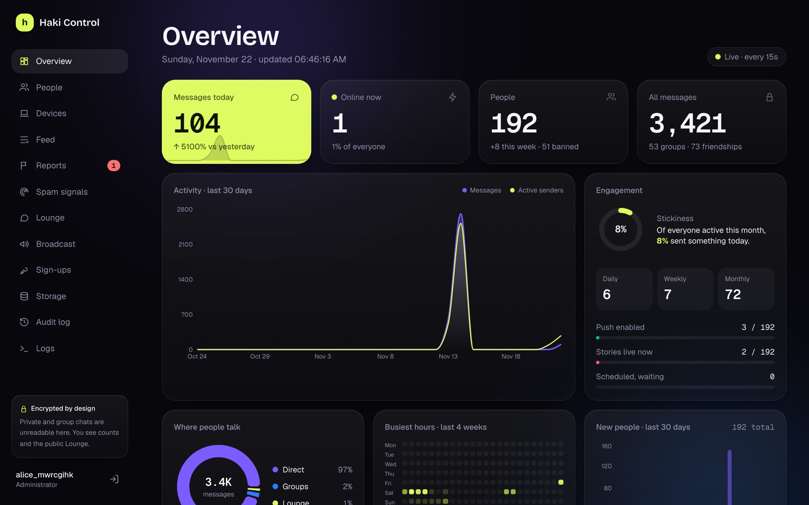
</p>
<p align="center">
  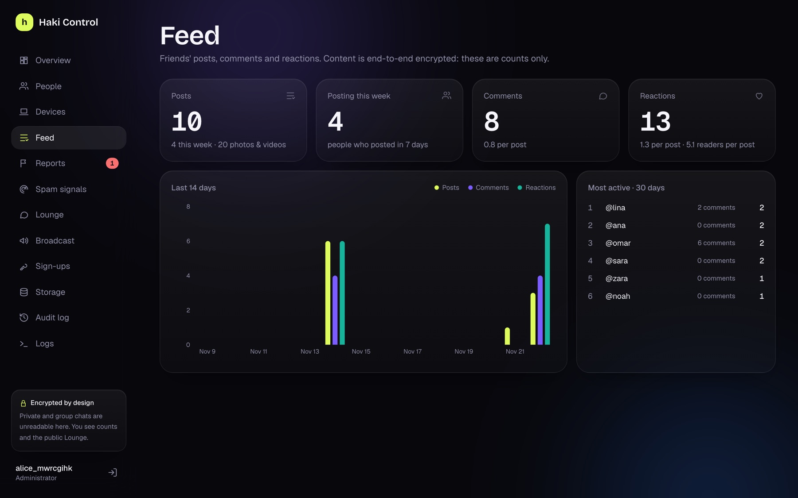
  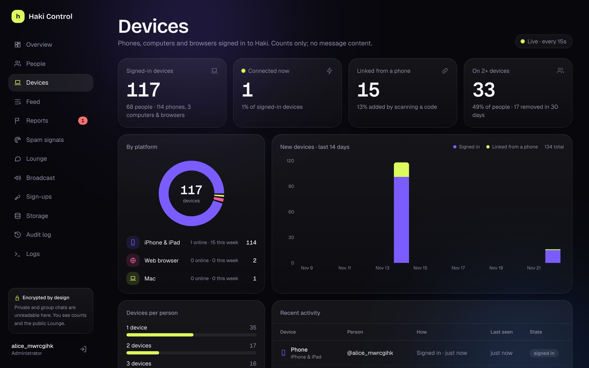
</p>

## What you need

- Docker Desktop (runs Postgres, the API, the dashboard and a TURN server)
- Flutter 3.47 or newer (`flutter doctor` should be green for the platforms you want)
- Xcode for iOS and macOS, Android Studio for Android, Visual Studio with "Desktop development with C++" for Windows
- Node.js 22 if you want to run the backend or dashboard outside Docker

## Run it locally

### 1. Start the server side

```bash
cd haki-backend
cp .env.example .env     # then set POSTGRES_PASSWORD, JWT_SECRET and TURN_PASSWORD
docker compose up -d --build
```

Generate the secrets with `openssl rand -hex 32`.

This starts:

| Service | URL |
| --- | --- |
| API + WebSocket | http://localhost:3000 |
| Admin dashboard | http://localhost:3001 |
| Postgres | localhost:5432 (user, password and db from `.env`) |
| TURN (calls) | localhost:3478 |

The API runs in watch mode with the source mounted, so backend edits reload by themselves. Tables are created automatically on first start.

Check it is up:

```bash
curl http://localhost:3000/auth/signup
```

### 2. Run the app

```bash
cd haki_mobile
flutter pub get
flutter run                      # pick a device, or add -d <device id>
```

Calls use the TURN user and password from `.env`. Pass them to the app too:
`--dart-define=TURN_USER=haki --dart-define=TURN_PASSWORD=...`

The app talks to `http://localhost:3000` by default, which works for the iOS simulator, macOS, Windows and web. For anything else pass the server address:

```bash
# Android emulator (the host machine is 10.0.2.2 there)
flutter run -d emulator-5554 --dart-define=API_URL=http://10.0.2.2:3000

# A real phone on the same Wi-Fi: use your computer's LAN IP
flutter run -d <phone> --dart-define=API_URL=http://192.168.1.20:3000

# Web
flutter run -d chrome
```

Sign up in the app, write down the 12 recovery words, then sign up a second account (another simulator, or the web build) and add each other with the Haki code to chat.

### 3. Open the admin dashboard

Any account can be made an admin from the database:

```bash
docker exec haki_db psql -U user -d haki_db -c "update users set role='admin' where username='YOUR_USERNAME'"
```

Then sign in at http://localhost:3001 with that account.

## Tests

```bash
# Backend: two-user end-to-end checks over real HTTP and Socket.IO (stack must be running)
cd haki-backend && node scripts/smoke-test.js

# App
cd haki_mobile && flutter analyze && flutter test

# Type checks
cd haki-backend && npx tsc --noEmit
cd haki-dashboard && npx tsc --noEmit
```

## Building releases

```bash
cd haki_mobile
flutter build ipa      --dart-define=API_URL=https://api.your-domain.com   # iOS
flutter build appbundle --dart-define=API_URL=https://api.your-domain.com  # Android
flutter build macos    --dart-define=API_URL=https://api.your-domain.com
flutter build windows  --dart-define=API_URL=https://api.your-domain.com   # on a Windows PC
flutter build web      --dart-define=API_URL=https://api.your-domain.com
```

The dashboard reads the API address from `NEXT_PUBLIC_API_URL` at build time.

## Deploying the server

The same `docker-compose.yml` runs on any Linux VPS with Docker. Before going public:

1. Use fresh, random values in `haki-backend/.env` for `JWT_SECRET`, `POSTGRES_PASSWORD` and `TURN_PASSWORD`.
2. Put HTTPS in front of ports 3000 and 3001 (Caddy, nginx, or a Cloudflare Tunnel).
3. Open UDP 3478 and 60000–60050 for the TURN server, or point the app at a hosted TURN service.
4. Optional, for iOS push: set the `APNS_*` variables (commented out in the compose file) from an Apple Developer APNs key.
5. Back up the `postgres_data` volume and `haki-backend/uploads/`.

## Project layout

```
haki-backend/src
  auth/       sign-up, login, sessions, linked devices, 2-step login
  chat/       messages, reactions, gateway events
  groups/     group chats and calls
  stories/    sealed stories with per-friend keys
  feed/       sealed posts, comments, reactions
  admin/      dashboard endpoints (counts only)
haki_mobile/lib
  features/   one folder per screen area (view + view_model)
  services/   API, socket, crypto, push, WebRTC
  core/       theme, icons (HakiIcons), shared widgets
haki-dashboard/src/app/dashboard
  one file per dashboard page
```

## License

Haki is licensed under the [GNU Affero General Public License v3.0](LICENSE). If you run a modified version of Haki as a service, you must make your changes available to its users under the same license.
